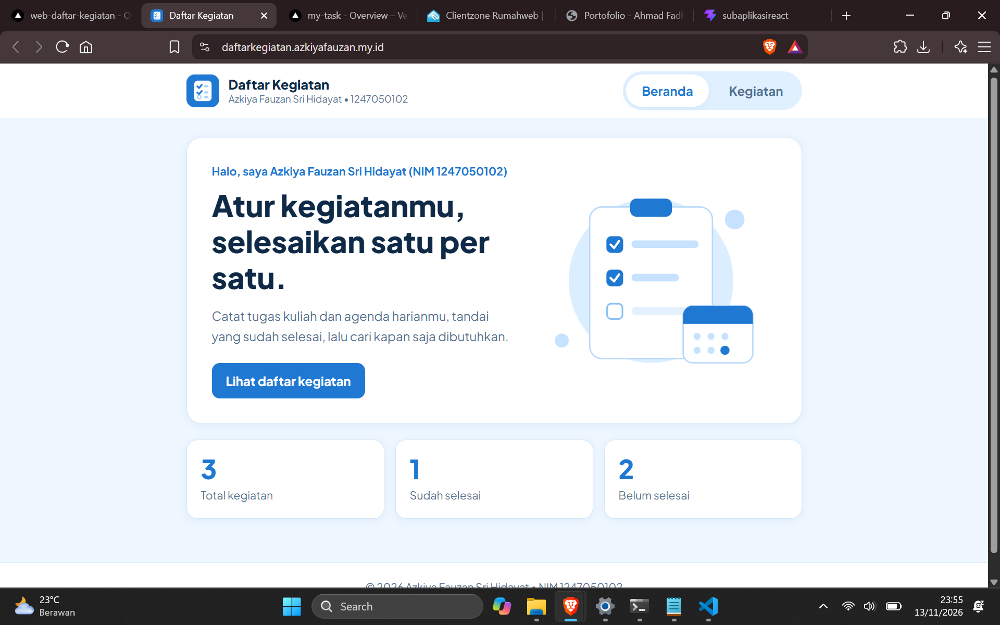
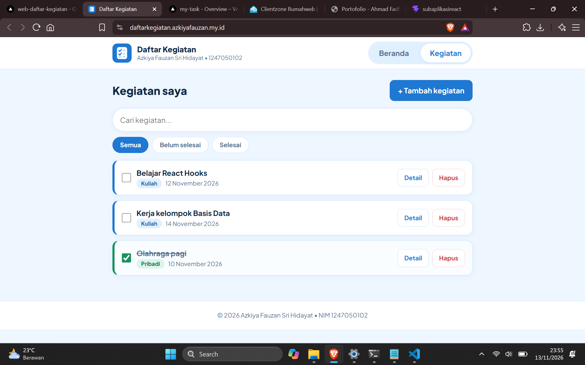
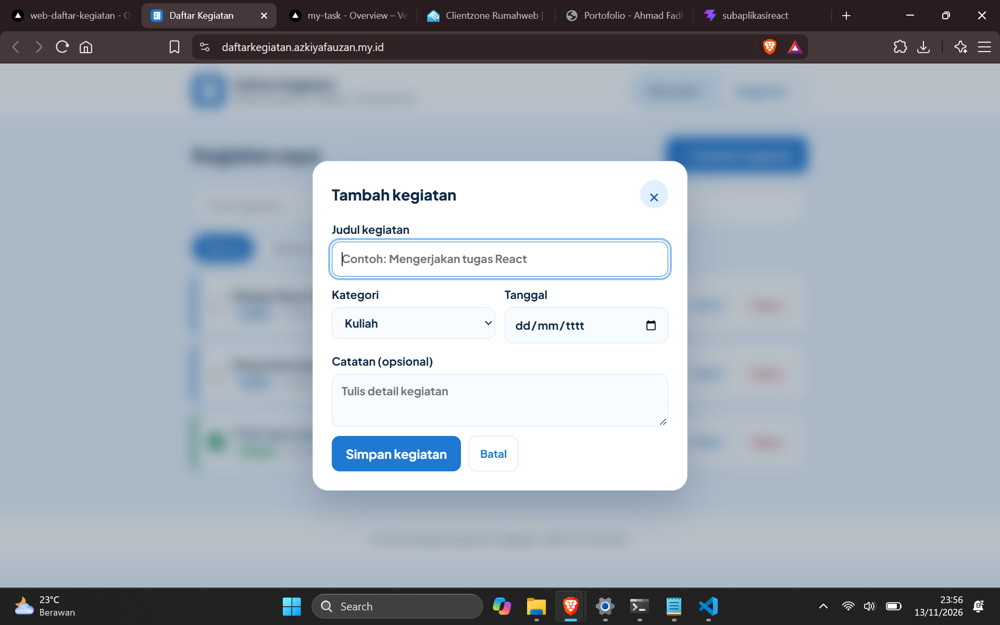
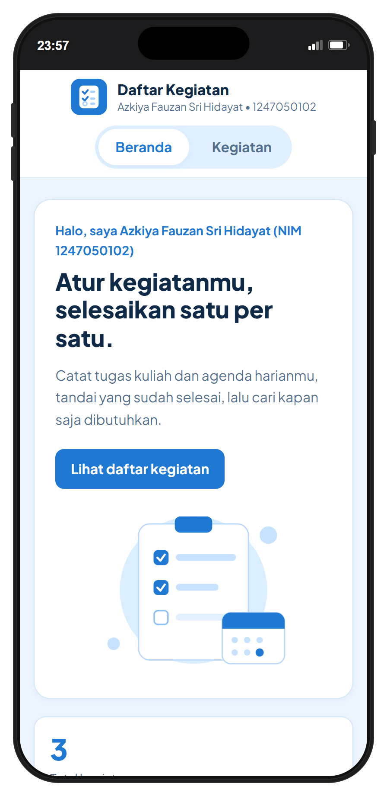

# Daftar Kegiatan

Aplikasi web sederhana untuk mencatat dan mengelola kegiatan harian, dibuat untuk tugas **Component-Based UI Development** menggunakan React.

| | |
|---|---|
| **Nama** | Azkiya Fauzan Sri Hidayat |
| **NIM** | 1247050102 |
| **Website (online)** | https://daftarkegiatan.azkiyafauzan.my.id/ |
| **Repository GitHub** | https://github.com/Azkiya51/Web_Daftar_Kegiatan.git |

## Teknologi

- **React 18**: library untuk membangun antarmuka berbasis komponen
- **Vite**: build tool dan development server
- **JavaScript (JSX)**: logika dan tampilan komponen
- **CSS**: gaya tampilan (flexbox, grid, CSS variables, media query)

## Screenshot

| Beranda | Daftar Kegiatan |
|---|---|
|  |  |

| Pop up Tambah Kegiatan | Tampilan Mobile |
|---|---|
|  |  |

## Fitur Interaktif

1. **Menambah kegiatan** lewat pop up formulir (dengan validasi input kosong)
2. **Menghapus kegiatan**
3. **Mengubah status** kegiatan (selesai / belum) dengan checkbox
4. **Mencari kegiatan** berdasarkan judul
5. **Memfilter kegiatan** berdasarkan status (Semua, Belum selesai, Selesai)
6. **Menampilkan / menyembunyikan detail** catatan kegiatan
7. Data tersimpan otomatis di browser (`localStorage`)

## Komponen React

Aplikasi terdiri dari 11 komponen yang dipisahkan di folder `src/components/`, ditambah komponen utama `App.jsx`.

| Komponen | Fungsi |
|---|---|
| `Navbar` | Navigasi antar halaman (Beranda dan Kegiatan), menampilkan logo, nama, dan NIM |
| `Header` | Bagian pembuka halaman beranda |
| `Stats` | Menampilkan ringkasan jumlah kegiatan |
| `StatCard` | Kartu satu statistik (reusable, dipakai 3 kali oleh `Stats`) |
| `ActivityForm` | Formulir untuk menambah kegiatan baru |
| `SearchFilter` | Kolom pencarian dan tombol filter status |
| `ActivityList` | Menampilkan seluruh daftar kegiatan |
| `ActivityItem` | Satu baris kegiatan beserta aksinya |
| `Button` | Tombol serbaguna (reusable) dengan beberapa varian |
| `Modal` | Pop up dengan latar belakang blur (reusable) |
| `Footer` | Bagian bawah halaman |

**Komponen reusable:** `Button` dipakai di banyak tempat (Header, Form, Daftar, tombol tambah) dengan props `variant` yang berbeda (`primary`, `ghost`, `danger`). `StatCard` dipakai berulang untuk tiga statistik, dan `Modal` bisa membungkus konten apa pun.

## Penjelasan Konsep React

### 1. Props (mengirim data dari parent ke child)

Props dipakai untuk mengirim data dan fungsi dari komponen induk ke komponen anak. Contoh di `App.jsx`:

```jsx
<ActivityList
  daftar={kegiatanTampil}
  onHapus={hapusKegiatan}
  onUbahStatus={ubahStatus}
/>
```

`ActivityList` meneruskannya ke `ActivityItem` lewat props `kegiatan`, `onHapus`, dan `onUbahStatus`. Props lain yang dipakai: `nama` dan `nim` (dikirim ke `Navbar`, `Header`, `Footer`), `total` dan `selesai` (ke `Stats`), `judul` dan `onTutup` (ke `Modal`), serta `variant` dan `children` (ke `Button`).

Alur data: **state di `App` turun ke anak lewat props**, sedangkan **aksi dari anak naik ke `App` lewat fungsi** (misalnya `onHapus`, `onTambah`).

### 2. State (`useState`)

State dipakai untuk menyimpan data yang bisa berubah dan memicu tampilan diperbarui.

| Komponen | State | Fungsi |
|---|---|---|
| `App` | `halaman` | Halaman yang sedang aktif |
| `App` | `kegiatan` | Array seluruh data kegiatan |
| `App` | `keyword` | Kata kunci pencarian |
| `App` | `filter` | Filter status yang dipilih |
| `App` | `formTerbuka` | Apakah pop up tambah kegiatan terbuka |
| `ActivityForm` | `judul`, `kategori`, `tanggal`, `catatan`, `error` | Isi input formulir dan pesan kesalahan |
| `ActivityItem` | `detail` | Apakah detail kegiatan ditampilkan |

Selain `useState`, aplikasi memakai `useEffect` untuk menyimpan data ke `localStorage` setiap `kegiatan` berubah, serta untuk menutup pop up dengan tombol Esc di `Modal`.

### 3. Event Handling

| Event | Dipakai di | Fungsi |
|---|---|---|
| `onClick` | `Navbar`, `Button`, `SearchFilter`, `ActivityItem` | Pindah halaman, buka/tutup pop up, pilih filter, hapus, tampil/sembunyi detail |
| `onChange` | `ActivityForm`, `SearchFilter`, `ActivityItem` | Mengisi input, mencari kegiatan, mencentang status selesai |
| `onSubmit` | `ActivityForm` | Menyimpan kegiatan baru (memakai `e.preventDefault()` dan validasi) |
| `onKeyDown` (Esc) | `Modal` | Menutup pop up lewat keyboard |

### 4. Conditional Rendering

- Konten halaman berganti sesuai state `halaman` (Beranda atau Kegiatan)
- Pop up form hanya tampil saat `formTerbuka` bernilai `true`
- Pesan error muncul hanya jika input tidak valid
- Tampilan "belum ada kegiatan" muncul saat daftar kosong
- Detail kegiatan muncul saat tombol Detail diklik, dan teks tombol berubah menjadi Sembunyikan

### 5. List Rendering

Data array ditampilkan dengan `map()` dan `key` yang unik, misalnya daftar kegiatan di `ActivityList`:

```jsx
{daftar.map((k) => (
  <ActivityItem key={k.id} kegiatan={k} onHapus={onHapus} onUbahStatus={onUbahStatus} />
))}
```

`map()` juga dipakai untuk menu navigasi, tombol filter, dan kartu statistik.

## Struktur Folder

```
daftar-kegiatan/
├── public/favicon.svg
├── screenshots/
├── src/
│   ├── assets/            # logo dan ilustrasi (SVG)
│   ├── components/        # 11 komponen React
│   ├── App.jsx            # komponen utama, pusat state
│   ├── main.jsx           # entry point
│   └── index.css          # seluruh styling
├── index.html
├── vite.config.js
└── package.json
```

## Menjalankan di Komputer Lokal

```bash
git https://github.com/Azkiya51/Web_Daftar_Kegiatan.git
cd daftar-kegiatan
npm install
npm run dev
```

Buka alamat yang muncul di terminal (biasanya `http://localhost:5173`).

## Build untuk Publikasi

```bash
npm run build
```

Isi folder `dist/` diunggah ke hosting. Konfigurasi `base: './'` pada `vite.config.js` membuat aplikasi bisa berjalan dari subfolder website pribadi.
